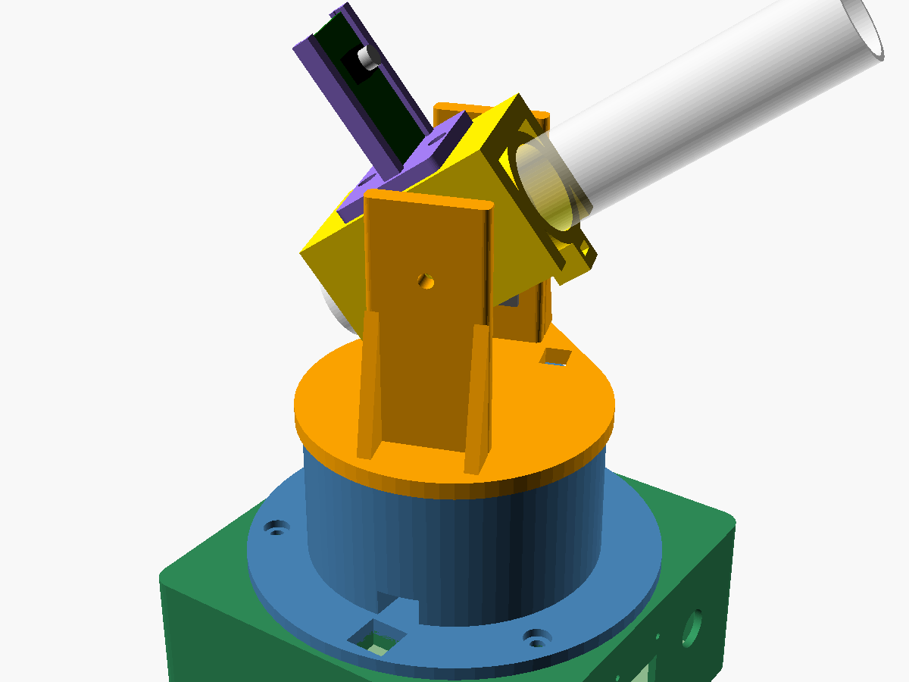
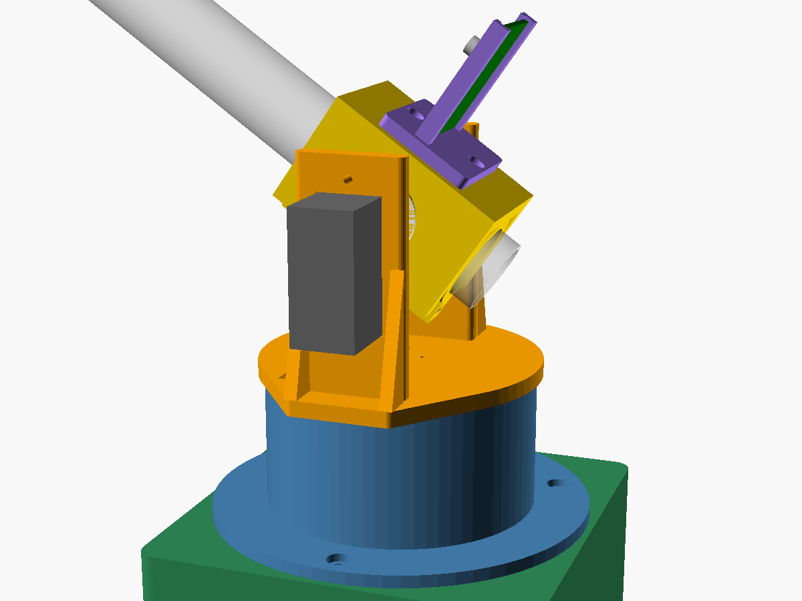

# Raketlanceerinstallatie

Op afstand bestuurbare, volgende (tracking) lanceerinstallatie met twee servo's,
een ESP32-CAM en 3D-geprinte onderdelen, plus een vaste sokkel met OLED-gezicht
en spraak (ESP32-S3, microfoon, luidspreker).




## Mechanisch ontwerp (`cad/launcher.scad`)

Parametrisch OpenSCAD-model. Standaard voor **MG995** servo's (zelfde maat als
MG996R); zet `pan_servo` / `tilt_servo` op `"SG90"` voor de kleine servo's
(verlaag dan ook `tilt_z` naar ±42).

| Onderdeel | STL | Printen | Benodigd |
|---|---|---|---|
| Voet (pan-servo) | `stl/base.stl` | zoals hij ligt, geen support | MG995, 2× servoschroef, 3× M4 |
| Draaiplateau met juk | `stl/pan.stl` | plateau op het bed, support alleen onder de servo-uitsparing | MG995 + ronde horn, 4× M2 hornschroefjes, M4×30 + moer (draaipunt) |
| Wieg (buisklem) | `stl/cradle.stl` | staand op de achterring, geen support | ronde horn, 2× M3×10 + moer (buis borgen), M4 moer |
| ESP32-CAM-houder | `stl/camholder.stl` | zoals hij ligt | 2× M3×10 + moer |
| Sokkel met gezicht | `stl/head.stl` | ondersteboven (bovenkant op het bed) | 3× M4 moer, OLED met 4× M2, drukknop Ø12 |
| Bodemplaat sokkel | `stl/head_lid.stl` | zoals hij ligt | 4× M3×8 (zelftappend in de bussen) |

Instellingen bovenaan het bestand: buisdiameter (`tube_d`, standaard 25 mm),
lengte van de wieg, hoogte van de tilt-as, OLED-maat (0,96" of 1,3"),
speling (`clr`). Opnieuw exporteren:

```sh
cd cad && ./export.sh                          # standaard (MG995)
./export.sh -D 'pan_servo="SG90"' -D 'tilt_servo="SG90"' -D tilt_z=42
```

### Opbouw

1. **Voet**: de pan-servo zakt van boven in het blok en rust op zijn oren. De
   bovenrand van de ring vangt het plateau op, zodat de servo-as niet de hele
   last draagt. Kabel via de goot en het gat in de vloer naar de sokkel.
2. **Draaiplateau**: ronde horn in de verdieping aan de onderkant, vastzetten
   met 4 schroefjes van boven. De tilt-servo schuift van binnenuit door de
   rechterstaander, oren tegen de binnenkant.
3. **Wieg**: ronde horn in de rechterzijplaat, links een M4-bout door de
   staander als draaipunt (moer in de wieg). De buis wordt met twee M3-schroeven
   van onderen geborgd.
4. **ESP32-CAM** schuift van boven in de houder, camera in de schietrichting.
   De achterlip is maar 0,6 mm zodat de pinheaders vrij blijven.
5. **Sokkel**: OLED-gezicht en praatknop voorin, luidspreker (40 mm) links,
   microfoon (INMP441, Ø14) rechts, USB-C van de ESP32-S3 achter. De ESP32-S3
   en MAX98357A liggen met dubbelzijdig tape op de balkjes van de bodemplaat.

### Bereik en aandachtspunten

- Kantelbereik ongeveer 0° (horizontaal) tot 90° (recht omhoog). Onder 0° raakt
  de buis het plateau: begrens dit in de firmware.
- Zet de horns zo dat het midden van de servo (90°) overeenkomt met 45° elevatie.
- Maten van servo's, ESP32-CAM en OLED zijn typische waarden. Meet je eigen
  onderdelen na en pas de tabel `servo_dims` of de OLED-maten aan.
- Bij een raket met motor: zorg voor een vlamschild/afbuiger achter de buis,
  de uitlaat mag niet op de elektronica blazen.
