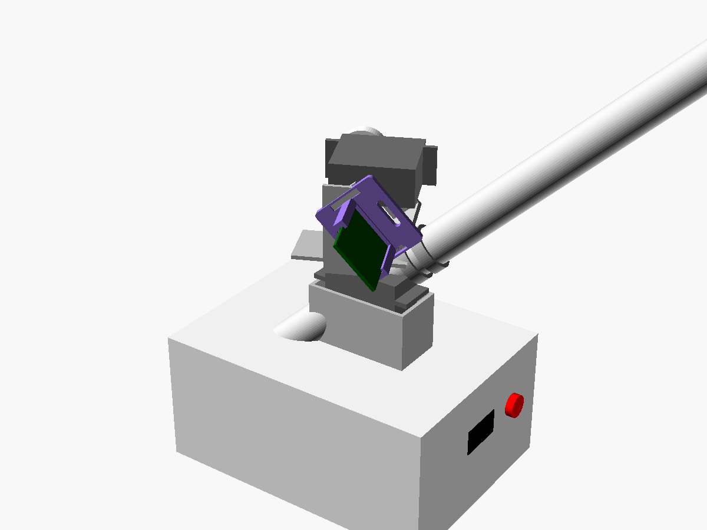

# Raketlanceerinstallatie

Op afstand bestuurbare, volgende (tracking) lanceerinstallatie met twee servo's,
een ESP32-CAM, plus een vaste "kop" met OLED-gezicht en spraak (ESP32-S3,
microfoon, luidspreker).

## Bouw met minimale 3D-prints (aanbevolen)



Alles is te koop als standaardonderdeel. Er is **één klein printdeel**: de clip
voor de ESP32-CAM (`stl/camclip.stl`, ±8 g, 15 min, geen support), omdat die
print geen montagegaten heeft. Zonder printer kan het ook met dubbelzijdig
foamtape of tie-wraps.

### Onderdelenlijst

| Wat | Zoekterm / voorbeeld | Aantal |
|---|---|---|
| Servo's | MG995 (heb je al) | 2 |
| Pan/tilt-beugelset voor MG995/MG996R, aluminium | "MG996R 2DOF pan tilt bracket" (multifunctionele beugel + lange U-beugel + ronde metalen horns + lager) | 1 set |
| Lanceerbuis | PVC-installatiebuis 20 mm (bouwmarkt, per 2 m) | 30 cm |
| Buisklemmen | klemzadel / buisclip 20 mm met schroefgat | 2 |
| Projectdoos (de kop) | ABS-aansluitdoos ±150 × 110 × 70 mm | 1 |
| OLED 0,96" SSD1306, INMP441, MAX98357A, 40 mm luidspreker, drukknop Ø12 | zie `voice-face/README.md` | 1 elk |
| Bouten | M3 × 10 met moer (klemmen, camclip, beugel op deksel), M2 × 6 (OLED) | ±12 |
| Afstandsbusjes | M3 nylon, 10 mm (ESP32-S3 / versterker in de doos) | 4 |

### Opbouw

1. **Kop**: boor in de voorkant van de doos een venster van 23 × 13 mm voor de
   OLED (4 gaatjes Ø2,2 op 23 × 23 mm), een gat Ø12 voor de praatknop, in de
   linkerzijkant een rooster van gaatjes Ø2 voor de luidspreker en in de
   rechterzijkant één gaatje Ø2,5 voor de microfoon. Achter een sleuf voor USB-C.
2. **Pan**: schroef de multifunctionele beugel met de pan-servo (as omhoog)
   met 4× M3 op het deksel. Boor een gat van Ø10 naast de beugel voor de kabels.
3. **Tilt**: de tweede multifunctionele beugel komt op de ronde horn van de
   pan-servo, met de tilt-servo liggend erin. De lange U-beugel gaat op de
   horn van de tilt-servo en aan de andere kant op het lager uit de set.
4. **Buis**: twee buisklemmen met M3 op de bodem van de U-beugel, buis erin
   klikken. Schuif hem zo ver naar voren dat hij in balans hangt.
5. **Camera**: camclip met 2× M3 op de zijkant van de U-beugel (de sleufgaten
   passen op elk gatenpatroon), ESP32-CAM van boven in de rails schuiven, lens
   in de schietrichting.

Kantelbereik ongeveer 0° tot 90°, begrens het in de firmware zodat de buis
het deksel niet raakt. Bij een raket met motor: vlamschild achter de buis.

Model: `cad/minimal.scad` (`part="camclip"` om te exporteren,
`part="assembly"` om de opbouw te bekijken; de beugels in de weergave zijn
schematisch).

## Alternatief: alles zelf printen (`cad/launcher.scad`)

Voor wie geen beugelset wil kopen: een volledig geprinte versie.


Parametrisch OpenSCAD-model. Standaard voor **MG995** servo's (zelfde maat als
MG996R); zet `pan_servo` / `tilt_servo` op `"SG90"` voor de kleine servo's
(verlaag dan ook `tilt_z` naar ±42).

| Onderdeel | STL | Printen | Benodigd |
|---|---|---|---|
| Voet (pan-servo) | `stl/base.stl` | zoals hij ligt, geen support | MG995, 2× servoschroef, 3× M4 |
| Draaiplateau met juk | `stl/pan.stl` | plateau op het bed, support alleen onder de servo-uitsparing | MG995 + ronde horn, 4× M2 hornschroefjes, M4×30 + moer (draaipunt) |
| Wieg (buisklem) | `stl/cradle.stl` | staand op de achterring, geen support | ronde horn, 2× M3×10 + moer (buis borgen), M4 moer |
| ESP32-CAM-houder | `stl/camholder.stl` | zoals hij ligt | 2× M3×10 + moer |
| Sokkel met gezicht | `stl/head.stl` | ondersteboven (bovenkant op het bed) | 3× M4 moer, OLED met 4× M2, drukknop Ø12 |
| Bodemplaat sokkel | `stl/head_lid.stl` | zoals hij ligt | 4× M3×8 (zelftappend in de bussen) |

Instellingen bovenaan het bestand: buisdiameter (`tube_d`, standaard 25 mm),
lengte van de wieg, hoogte van de tilt-as, OLED-maat (0,96" of 1,3"),
speling (`clr`). Opnieuw exporteren:

```sh
cd cad && ./export.sh                          # standaard (MG995)
./export.sh -D 'pan_servo="SG90"' -D 'tilt_servo="SG90"' -D tilt_z=42
```

### Opbouw (geprinte versie)

1. **Voet**: de pan-servo zakt van boven in het blok en rust op zijn oren. De
   bovenrand van de ring vangt het plateau op, zodat de servo-as niet de hele
   last draagt. Kabel via de goot en het gat in de vloer naar de sokkel.
2. **Draaiplateau**: ronde horn in de verdieping aan de onderkant, vastzetten
   met 4 schroefjes van boven. De tilt-servo schuift van binnenuit door de
   rechterstaander, oren tegen de binnenkant.
3. **Wieg**: ronde horn in de rechterzijplaat, links een M4-bout door de
   staander als draaipunt (moer in de wieg). De buis wordt met twee M3-schroeven
   van onderen geborgd.
4. **ESP32-CAM** schuift van boven in de houder, camera in de schietrichting.
   De achterlip is maar 0,6 mm zodat de pinheaders vrij blijven.
5. **Sokkel**: OLED-gezicht en praatknop voorin, luidspreker (40 mm) links,
   microfoon (INMP441, Ø14) rechts, USB-C van de ESP32-S3 achter. De ESP32-S3
   en MAX98357A liggen met dubbelzijdig tape op de balkjes van de bodemplaat.

### Bereik en aandachtspunten

- Kantelbereik ongeveer 0° (horizontaal) tot 90° (recht omhoog). Onder 0° raakt
  de buis het plateau: begrens dit in de firmware.
- Zet de horns zo dat het midden van de servo (90°) overeenkomt met 45° elevatie.
- Maten van servo's, ESP32-CAM en OLED zijn typische waarden. Meet je eigen
  onderdelen na en pas de tabel `servo_dims` of de OLED-maten aan.
- Bij een raket met motor: zorg voor een vlamschild/afbuiger achter de buis,
  de uitlaat mag niet op de elektronica blazen.
